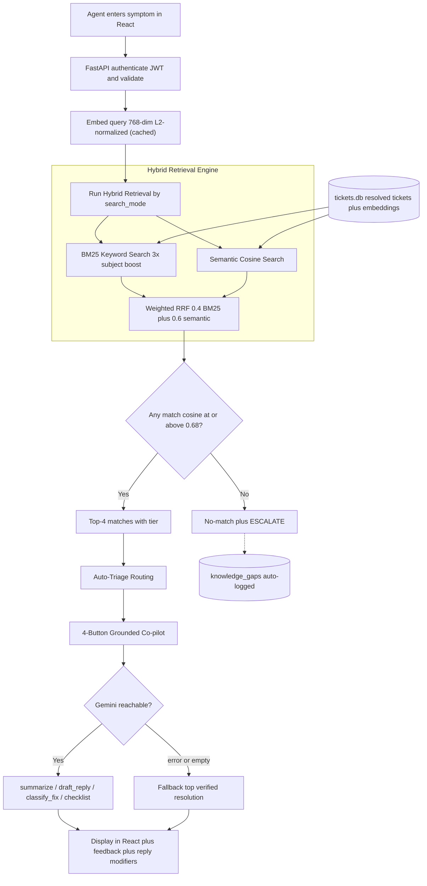

# Solari Analytics — Support Agent-Assist & Resolution Intelligence

Given a new support ticket's symptoms, this app retrieves the most similar
**historically resolved** tickets (with confidence scores) and offers a grounded
LLM co-pilot (summarize / draft reply / classify / checklist). When nothing
clears the confidence floor, it **refuses honestly, escalates, and logs a
knowledge gap** instead of guessing. Full JWT auth with agent/admin roles.

**Stack:** FastAPI + SQLite + Gemini (backend) · React + Vite + Tailwind (frontend).

## What was built (all verified locally)

- **Hybrid retrieval** — BM25 keyword (3× subject boost) + semantic cosine
  (`gemini-embedding-001`, 768-dim, L2-normalized) fused with **weighted RRF**
  (`k=60`, 0.4 BM25 / 0.6 semantic). Search mode toggle: hybrid / bm25 / semantic.
- **Confidence floor + tiering** — cosine ≥ **0.68** to match; HIGH at ≥ 0.78.
  Below the floor → no match + ESCALATE route + auto-logged knowledge gap.
- **Grounded 4-button co-pilot** (`gemini-3.1-flash-lite`) — Summarize, Draft
  Reply (+ tone/format modifier chips), Classify Fix, Checklist. Strictly
  grounded in retrieved tickets; prompt-injection hardened; resilient fallback
  to the top ticket's resolution on API error.
- **Auth + RBAC** — register/login, JWT (HS256, 12h), Argon2 hashing, live
  `is_active` re-check per request (instant kick), admin-only endpoints.
- **Admin console** — knowledge-gap review with **live KB indexing on approval**,
  plus team management (promote / revoke agents).
- **Golden benchmark** — Recall@4 and guardrail pass rate over a live test set.

## Requirement → file map

| Capability                                                               | Where                                                                  |
| ------------------------------------------------------------------------ | ---------------------------------------------------------------------- |
| Ingest + embed tickets → `tickets.db`                                    | `ingest_tickets.py`                                                    |
| CLI: top-N similar tickets for an ID                                     | `search_by_id.py`                                                      |
| Backend API (all endpoints, retrieval, co-pilot, auth, admin, benchmark) | `main.py`                                                              |
| Hybrid retrieval + RRF + confidence floor                                | `main.py` → `run_search`, `recommended_route`                          |
| Co-pilot prompts + injection guardrails + fallback                       | `main.py` → `SYSTEM_PROMPT`, `build_prompt`, `api_copilot`             |
| Auth / JWT / RBAC                                                        | `main.py` → `create_access_token`, `get_current_user`, `require_admin` |
| Knowledge gaps + live indexing                                           | `main.py` → `log_knowledge_gap`, `api_approve_gap`                     |
| React app shell + routing + auth gate                                    | `frontend/src/App.jsx`, `context/AppContext.jsx`                       |
| API client (JWT `authFetch`, graceful fallbacks)                         | `frontend/src/api.js`                                                  |
| Agent workspace (search, matches, modes)                                 | `frontend/src/pages/Workspace.jsx`, `components/MatchCard.jsx`         |
| Co-pilot UI + reply modifier chips                                       | `frontend/src/components/CopilotPanel.jsx`                             |
| Login / register                                                         | `frontend/src/pages/Login.jsx`                                         |
| Admin console (gaps + team mgmt)                                         | `frontend/src/pages/Admin.jsx`                                         |
| Eval benchmark UI                                                        | `frontend/src/pages/Benchmark.jsx`                                     |
| Starter data (40 resolved + incoming tickets)                            | `starter_kit/data/`                                                    |
| Legacy single-file demo (no React build needed)                          | `templates/index.html` (served at `/`)                                 |

## Run

**Prereqs:** Python 3.12, Node 18+, a Google AI Studio key.

1. **Env** — create `.env` in the project root (see `.env.example`):
   ```
   GEMINI_API_KEY=your_key_here
   JWT_SECRET=any-long-random-string   # optional; dev default exists
   ```
2. **Backend:**
   ```
   pip install fastapi "uvicorn[standard]" pydantic numpy rank_bm25 google-genai python-dotenv PyJWT "pwdlib[argon2]"
   python ingest_tickets.py            # one-time: builds tickets.db (already present here)
   uvicorn main:app --reload --port 8000
   ```
3. **Frontend:**
   ```
   cd frontend
   npm install
   npm run dev                         # http://localhost:5173
   ```
4. **Log in** with a seeded account (or the "Quick Fill" buttons):
   - Admin: `admin@solari.io` / `admin123`
   - Agent: `agent@solari.io` / `agent123`

> No React build required to demo retrieval + co-pilot: open `http://localhost:8000/`
> for the legacy single-file UI served by FastAPI.

## Test / verify

- **Golden benchmark:** open `/benchmark` in the app, or `GET http://localhost:8000/api/benchmark`
  → expect **Recall@4 = 100%** and **guardrail pass = 100%**.
- **Guardrail:** on `/workspace`, click **+ Unseen Bug Test** → returns no match,
  ESCALATE route, and logs a knowledge gap (visible to an admin under `/admin`).
- **Grounding + co-pilot:** load a scenario pill (e.g. a billing ticket), Search,
  then run the 4 co-pilot actions; Draft Reply exposes shorter/bullets/apology chips.
- **RBAC (instant kick):** log in as admin, kick the agent under `/admin` → the
  agent's next request returns 403 and the SPA forces logout.
- **CLI check:** `python search_by_id.py NT-3` → top-4 similar resolved tickets.
- **API docs:** `http://localhost:8000/docs` (FastAPI Swagger) for every endpoint.

## Trade-offs and gaps (honest)

- **Live model dependency.** Search/co-pilot need `GEMINI_API_KEY` + network;
  embedding adds latency. Mitigated by an in-memory **query-embedding cache**
  (repeat queries skip the API) and a **fallback** that returns the top verified
  resolution if the LLM errors, so a demo never shows a 500.
- **Confidence floor is dataset-tuned.** `0.68` was calibrated for these 40
  tickets because the embedding model has a high similarity baseline (raised from
  0.55 so nonsense queries are rejected). A different corpus needs re-tuning.
- **768-dim embeddings** (truncated from 3072) trade a little fidelity for 4×
  smaller/faster vectors; recall stayed 100% at this scale. Requires manual
  L2-normalization (applied at every embedding site).
- **In-memory index + single-writer SQLite.** Perfect for 40 tickets and a demo;
  not horizontally scalable. The BM25/embedding index rebuilds on startup and on
  each admin gap-approval (no restart needed, but process-local).
- **Feedback counts are in-memory** — the 👍/👎 precision badge resets on restart
  (not persisted).
- **Auth is demo-grade.** JWT stored in browser `localStorage` (XSS-exposed vs an
  HttpOnly cookie); `JWT_SECRET` has a dev fallback; no refresh tokens. Role
  checks are enforced server-side, and public registration can only create agents.
- **Not yet built:** bulk document/ticket upload (KB grows only via gap approval),
  persisted feedback, and cloud deployment (Azure steps drafted but not executed).

---

<details>
<summary>Deeper detail (architecture diagram, full API table, evaluation, project structure)</summary>

## Architecture (symptom → matches → co-pilot)



## API endpoints

| Method      | Endpoint                        | Purpose                              | Access        |
| ----------- | ------------------------------- | ------------------------------------ | ------------- |
| POST        | `/api/auth/register`            | Register (always agent)              | Public        |
| POST        | `/api/auth/login`               | Sign in → JWT                        | Public        |
| GET         | `/api/auth/me`                  | Current user + role                  | Signed-in     |
| POST        | `/api/search`                   | Hybrid search → matches + routing    | Agent + Admin |
| GET         | `/api/tickets/incoming`         | Sample incoming + historical tickets | Open          |
| POST        | `/api/copilot`                  | 4 actions + reply `modifier`         | Agent + Admin |
| POST        | `/api/feedback`                 | 👍/👎 vote                           | Agent + Admin |
| GET         | `/api/feedback/stats`           | Live precision stats                 | Open          |
| GET         | `/api/admin/gaps`               | Open knowledge gaps                  | Admin only    |
| POST        | `/api/admin/gaps/{id}/approve`  | Approve + live-index                 | Admin only    |
| GET         | `/api/admin/users`              | List team                            | Admin only    |
| PATCH       | `/api/admin/users/{id}/promote` | Promote agent → admin                | Admin only    |
| POST/DELETE | `/api/admin/users/{id}/kick`    | Revoke (soft-delete)                 | Admin only    |
| GET         | `/api/benchmark`                | Golden evaluation suite              | Open          |
| GET         | `/`                             | Legacy Jinja2 demo page              | Open          |

Example `/api/search` response:

```json
{
  "matches": [
    {
      "rank": 1,
      "ticket_id": "T-1303",
      "category": "billing",
      "subject": "Charged twice for the same billing cycle",
      "resolution_notes": "Refunded the duplicate charge; added idempotency keys...",
      "confidence_pct": 81.9,
      "confidence_tier": "HIGH",
      "cosine_sim": 0.819
    }
  ],
  "latency_ms": 142.0,
  "below_threshold": false,
  "recommended_route": {
    "queue": "Billing & Account Ops",
    "badge": "BILLING POLICY",
    "reason": "Matched T-1303 (81.9%)"
  }
}
```

## Evaluation

- **Retrieval:** Recall@4 (expected same-category match in top 4), Precision@K, MRR.
- **Answer quality:** groundedness, citation accuracy, format adherence.
- **Guardrail/abstention:** guardrail pass rate, false-answer rate, injection resistance.
- **Results (local):** Recall@4 100%, guardrail 100%, injection payloads escaped, fallback verified against a real API error.

## Project structure

```text
HCL_hackathon/
├── main.py                 # FastAPI: retrieval, co-pilot, auth, admin, benchmark
├── ingest_tickets.py       # Embed + index resolved tickets into tickets.db
├── search_by_id.py         # CLI: top-N similar tickets for a ticket_id
├── tickets.db              # SQLite: resolved_tickets, users, knowledge_gaps
├── templates/index.html    # Legacy single-file demo (served at /)
├── frontend/
│   └── src/
│       ├── App.jsx                 # Router + auth shell
│       ├── api.js                  # authFetch + endpoint helpers
│       ├── context/AppContext.jsx  # auth + app state
│       ├── components/             # Navbar, Toast, MatchCard, CopilotPanel
│       └── pages/                  # Login, Workspace, Admin, Benchmark
├── starter_kit/data/       # tickets.json, new_tickets_example.json
├── .env.example            # GEMINI_API_KEY (req), JWT_SECRET (opt)
└── PROJECT_REPORT.docx     # Formal written report
```

## Design notes

- **Grounding + trust:** the co-pilot answers only from retrieved tickets and
  cites `[T-XXXX]`; the floor turns "retrieved" into "trustworthy."
- **Instant revocation:** role + active status come from the DB per request, not
  the token, so promote/kick take effect immediately.
- **Graceful degradation:** missing backend endpoints/fields degrade to presets
  and client-side derivation so the SPA always works; LLM errors fall back to
  verified resolutions.

</details>
